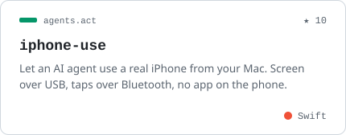
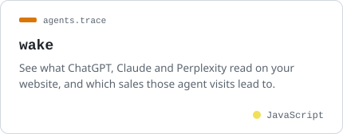
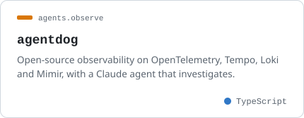
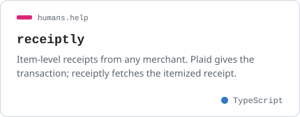
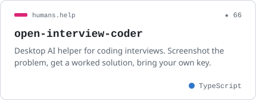
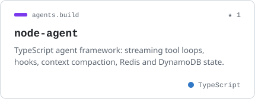

<picture>
  <source media="(prefers-color-scheme: dark)" srcset="assets/header-dark.svg">
  
</picture>

### Selected work

<a href="https://github.com/xhoantran/iphone-use"><picture><source media="(prefers-color-scheme: dark)" srcset="assets/card-iphone-use-dark.svg"></picture></a>
<a href="https://github.com/xhoantran/wake"><picture><source media="(prefers-color-scheme: dark)" srcset="assets/card-wake-dark.svg"></picture></a>
<a href="https://github.com/xhoantran/agentdog"><picture><source media="(prefers-color-scheme: dark)" srcset="assets/card-agentdog-dark.svg"></picture></a>
<a href="https://github.com/xhoantran/receiptly"><picture><source media="(prefers-color-scheme: dark)" srcset="assets/card-receiptly-dark.svg"></picture></a>
<a href="https://github.com/xhoantran/open-interview-coder"><picture><source media="(prefers-color-scheme: dark)" srcset="assets/card-open-interview-coder-dark.svg"></picture></a>
<a href="https://github.com/xhoantran/node-agent"><picture><source media="(prefers-color-scheme: dark)" srcset="assets/card-node-agent-dark.svg"></picture></a>

### Activity

<picture>
  <source media="(prefers-color-scheme: dark)" srcset="assets/activity-dark.svg">
  
</picture>

Currently building something new in stealth. Ask me about agent loops, MCP servers, and how agents can do more good for more people. Cards and stats refresh daily via <a href="scripts/build.mjs"><code>scripts/build.mjs</code></a>.
