  

  

<h3 align="center">Selected work</h3>

  
  
  
  
  
  

  

  

Every image here is generated from live GitHub data by <a href="scripts/build.mjs"><code>scripts/build.mjs</code></a> and refreshed daily.

